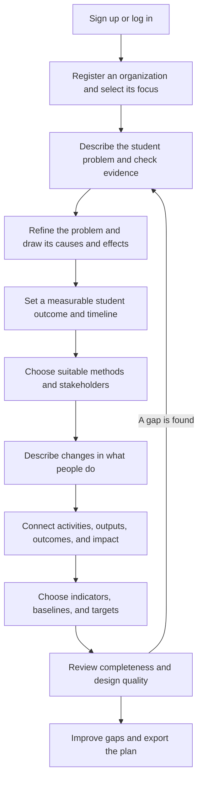
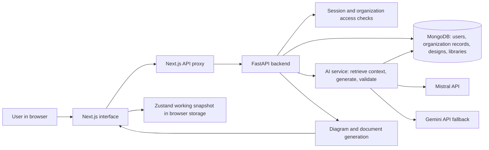

# MargDarshak: Problem, Solution, Architecture, and Workflow

## 1. The problem we are solving

Education organizations often know what they want to improve, but turning that intention into a clear program plan is difficult. A team may have a long description of a learning problem, several possible causes, and ideas for activities, yet no shared answer to these questions:

- What is the precise problem, and what evidence supports it?
- What change should students experience, and how will we measure it?
- Which teaching methods and people are needed to produce that change?
- How do the activities lead to the result we expect?
- What should we track, review, and show to partners or funders?

When these pieces are prepared separately, a program can end up with activities that do not address its main problem, targets without reliable starting measurements, and documents that are hard to explain. Smaller teams may also lack a specialist to guide the design process.

## 2. Solution title and purpose

**MargDarshak — From Blank Page to Blueprint** is a guided program-design workspace for education organizations. It helps a signed-in user register an organization, understand a learning problem, set a student goal, choose an approach, map the path from activities to impact, plan measurement, review design gaps, and export a readable plan.

The workspace uses the organization's selected theme, location, scale, and saved inputs. It combines visual planning tools with AI suggestions. Users review and edit those suggestions; the AI does not establish that an unverified claim is true.

### One example used throughout this document

The following is **fictional test data**, not a reported result: Aravali Learning Collective works with 25 schools in Gogunda. Many Grade 3 children recognize Hindi letters but struggle to read and explain a short paragraph. A test baseline is 35%, and the team wants to plan toward 70% within 18 months. Before using those figures in a real program, the team must verify the baseline and judge whether the target is feasible.

## 3. The complete user workflow

The stages guide the user, but sections can be revisited. For example, if a reading assessment shows that the main barrier is different from the first assumption, the team can revise the problem tree, method, and indicators before sharing the plan. Templates provide a starting structure at any suitable point; they do not replace the organization's own facts.

## 4. How the system is put together

1. **The interface** presents forms, diagrams, cards, charts, progress, and downloads. Its guided pages lead the user through the program design.
2. **The API proxy** passes browser requests and session cookies to the Python backend. The backend checks the signed-in user and organization before serving protected data.
3. **MongoDB** holds accounts, organization profiles, saved feature records, shared reference libraries, and cached AI embeddings. The current design snapshot used by several dashboard views and exports is also kept in the browser through Zustand's persisted store. That browser snapshot should not be confused with a single, fully server-stored design document.
4. **The AI service** retrieves relevant saved context, calls an LLM, checks the response shape, and returns structured suggestions. The interface turns those fields into readable cards rather than displaying raw JSON.
5. **The export service** turns the saved design into diagrams, a PDF report, a PowerPoint presentation, spreadsheets, or a Theory of Change image, depending on the selected format.

### Technology stack

| Part | Technologies used | Plain-language role |
| --- | --- | --- |
| Frontend | Next.js 16, React 19, TypeScript | Runs the website and its guided pages. |
| Styling and controls | Tailwind CSS, shadcn/ui components, Radix UI, Lucide | Makes the interface responsive and usable. |
| Browser state | Zustand | Keeps the current organization theme and working design snapshot available across pages. |
| Browser visuals | Mermaid, Recharts | Draws logic diagrams and measurement charts. |
| Backend API | Python 3.11 or 3.12, FastAPI, Pydantic | Receives requests, validates inputs, applies rules, and returns results. The local backend runs in `backend/.venv`. |
| Database | MongoDB through PyMongo | Stores accounts, organization-specific work, library records, and embedding cache entries. |
| Authentication | Password hashing with PBKDF2-SHA256; server sessions and HttpOnly cookies | Protects accounts and limits access to each user's organization. |
| AI and retrieval | Mistral API, Gemini API fallback, HTTPX, embeddings and similarity ranking | Finds relevant saved context and generates tailored suggestions. |
| Documents and diagrams | ReportLab, Pillow, python-pptx, OpenPyXL, NetworkX, Matplotlib | Produces the PDF, images, slides, spreadsheets, and graph visuals. |
| Language | English/Hindi UI text, language-aware AI prompts, translation handling | Makes the workflow usable in both supported languages. |

The active export choices are **PDF**, **PowerPoint**, **indicator spreadsheet**, **budget spreadsheet**, and **Theory of Change PNG**. Some installed libraries support other formats, but those formats should not be assumed to be available in the current export page.

**Two useful abbreviations:** FLN means **Foundational Literacy and Numeracy**: early reading, writing, and number skills. LFA means **Logical Framework Analysis**: a way to connect a program's problem, actions, expected results, and measures in one plan.

## 5. RAG, LLM, and agentic behavior in one workflow

These three terms describe different jobs in the same request:

- **RAG (Retrieval-Augmented Generation)** means finding relevant existing records *before* asking a model to write an answer. Here, the backend searches shared methodology/template references and the current organization's saved work. It creates embeddings, ranks records by similarity, and caches document embeddings in MongoDB. This is retrieval from the application's records, **not a live web search or proof that a statement is true**.
- **LLM (Large Language Model)** means the text model that reads the request and retrieved context, then proposes an answer. MargDarshak uses Mistral when configured, with Gemini as a fallback when available. The backend asks for a defined response shape, validates it, and passes the useful fields to the interface.
- **Agentic behavior** means the application guides a sequence of decisions rather than producing one isolated paragraph. Its backend and design coach look at the current design, identify the next incomplete part, call the appropriate AI task, check the result, and show a concrete next action. This is a **guided, task-specific workflow with human review**; the current code is not a free-running multi-agent system that autonomously changes an organization's plan.

### Example: one request from start to finish

1. Aravali writes its Grade 3 reading problem and selects **Refine**.
2. The backend checks that the request belongs to Aravali and gathers its profile, selected FLN theme, and relevant saved or shared reference records.
3. The RAG step embeds the question, compares it with reference embeddings, and sends the most relevant records with the request. Retrieved material from another place remains reference material, not local evidence for Gogunda.
4. Mistral, or Gemini if that provider is used as fallback, proposes a short problem gist, possible stakeholders, evidence to collect, and possible causes.
5. The backend checks that the answer has the expected fields and makes its values readable. The frontend displays editable text and visual cards.
6. The user accepts or changes the gist. Later steps use the saved problem to review the user's outcome, suggest milestones, explain methods, review a causal diagram, and propose practices and indicators. The design coach can point to the next incomplete step.
7. The user checks assumptions and actual measurements, repairs any gaps, and exports the final design.

**Human decision point:** AI suggestions are drafts. A suggested cause, baseline, target, or method becomes part of a credible plan only after the team checks it against local evidence and capacity.

## 6. What each feature means and why it matters

Every example below continues the fictional Gogunda reading case.

### 6.1 Account, organization registration, and private workspace

**Meaning:** A person creates an account and registers the organization whose program they are designing. The organization profile records its focus, location, reach, and team context.

**Why it matters:** Advice for a small reading program should reflect its actual setting. Sign-in and server-side ownership checks keep one organization's workspace separate from another's.

**Real-life example:** Aravali selects FLN, Gogunda, and 25 schools. Its dashboard uses those choices; another organization focused on career readiness sees its own profile and records.

### 6.2 Dashboard and guided stages

**Meaning:** The dashboard summarizes what has been entered and points to the next useful step. Its program map connects the problem, outcome, methods, people, and measures.

**Why it matters:** A new user can see the entire planning journey and where information is still missing.

**Real-life example:** Aravali has set a reading goal but has no indicator baseline yet. The dashboard directs the team to measurement before export.

### 6.3 Problem definition and AI refinement

**Meaning:** A problem statement explains *who is struggling, with what, and where*. AI refinement turns a long description into a short gist and suggests questions to investigate.

**Why it matters:** A precise problem keeps the team from jumping straight to a favorite activity without understanding the need.

**Real-life example:** Instead of starting with “we need tablets,” Aravali describes that many Grade 3 learners cannot explain a Hindi paragraph. The team can then test whether the main barriers involve materials, instruction, practice at home, or something else.

### 6.4 Evidence suggestions and problem tree

**Meaning:** Evidence is information that can support or challenge a claim. A problem tree is a diagram with **possible causes → core problem → possible effects**.

**Why it matters:** The tree makes assumptions visible, while evidence suggestions show what to verify before choosing an intervention.

**Real-life example:** The tree links mixed reading levels and limited reading practice to low paragraph comprehension. Aravali uses reading assessments, classroom observations, and caregiver conversations to check which links are real in its schools.

### 6.5 Student outcomes, SMART check, and timeline

**Meaning:** An *outcome* is the change students should experience. SMART means **Specific, Measurable, Achievable, Relevant, and Time-bound**. The timeline divides the path to the goal into reviewable steps.

**Why it matters:** A team needs to know what success looks like, how it will measure it, and when to check progress. The SMART check tests the wording and numbers; it cannot prove that a target is feasible in the field.

**Real-life example:** Aravali plans to move the share of Grade 3 learners who can read and explain a Hindi paragraph from a baseline it must verify toward 70% in 18 months. The timeline includes assessment, teacher preparation, practice, review, and endline measurement.

### 6.6 Methodology library

**Meaning:** A *methodology* is the practical approach the team will use, such as teacher coaching or small-group reading practice. The library explains approaches and lets the user save those suited to the organization.

**Why it matters:** A goal does not say *how* to reach it. Comparing methods helps the team choose actions that fit its problem, resources, and scale.

**Real-life example:** Aravali compares targeted reading groups with other FLN approaches and saves the method it can support across 25 schools.

### 6.7 Stakeholders and practice changes

**Meaning:** *Stakeholders* are people who affect or are affected by the program. A *practice change* is a specific change in what one of those people regularly does.

**Why it matters:** Student outcomes often depend on changes in adult behavior, materials, or school routines, not just a one-time activity.

**Real-life example:** Teachers begin checking reading levels monthly and giving each group suitable practice three times a week. Caregivers may be invited to support short reading time at home, where practical.

### 6.8 Theory of Change

**Meaning:** A Theory of Change is the explanation of how **activities → immediate outputs → student outcomes → longer-term impact** are connected. Each box is a step; arrows show the proposed links.

**Why it matters:** It lets the team see missing steps or weak assumptions before the program starts. Structural validation can find broken links and loops; it cannot prove that the causal story will work in practice.

**Real-life example:** Teacher training and reading materials are two activities. They lead to teachers running suitable sessions and students receiving suitable texts. Those outputs may help more students comprehend paragraphs, supporting later independent learning.

### 6.9 Indicators, baseline, current value, and target

**Meaning:** An *indicator* is a number or observation used to track a result. The *baseline* is the starting value, the *current value* is the latest real measurement, and the *target* is the desired future value.

When generating indicators, the backend gives each input a short internal ID. It maps the AI's answer back to the original outcome or practice and requests any omitted measure separately. This avoids relying on an LLM repeating long input text exactly.

**Why it matters:** These measures tell the team whether progress is happening and whether it should adjust the plan. A missing current value must not be shown as completed progress.

**Real-life example:** Aravali tracks the percentage of sampled Grade 3 learners who read and explain a paragraph using the same rubric. It records a verified baseline, later enters an actual midline result, and compares that result with the 70% target.

### 6.10 Quality check and design coach

**Meaning:** *Completeness* checks whether the necessary parts have been entered. *Design quality* flags issues such as a vague outcome, missing cause links, or indicators without baselines. The AI design coach suggests a practical next action.

**Why it matters:** A plan can look finished while still missing the information needed to use it. Feedback helps the team improve before sharing.

**Real-life example:** If Aravali has a target but no recorded baseline, the quality check identifies that gap and the coach can suggest arranging a reading assessment. A high design score does not mean the program has achieved its student goal.

### 6.11 Templates

**Meaning:** A template is a reusable planning structure. Users can read what it contains, fork a copy, give that copy a useful name, and save it for their organization.

**Why it matters:** It helps a team begin without a blank page while leaving room to replace examples with its own context and evidence.

**Real-life example:** Aravali forks a Grade 3 reading template, names its copy “Gogunda Reading Plan,” and fills in its actual schools, measurements, and responsibilities.

### 6.12 Exports and visual reports

**Meaning:** Export turns the working design into files that people can review or present: a PDF program report, PowerPoint slides, indicator and budget spreadsheets, and a Theory of Change image.

**Why it matters:** Partners need a clear account of the problem, plan, logic, and measures. Visual diagrams and charts make the reasoning easier to discuss.

**Real-life example:** Aravali shares a PDF with its problem tree, timeline, and indicator chart at a planning meeting, then uses the PowerPoint to explain the proposed reading pathway to school leaders.

### 6.13 English and Hindi support

**Meaning:** The interface provides English and Hindi labels, and AI tasks ask for user-facing content in the selected language.

**Why it matters:** People working on the same plan can review it in the language they use most comfortably.

**Real-life example:** Aravali's field coordinators inspect the problem tree and next-step guidance in Hindi while another team member prepares an English presentation.

## 7. What the finished blueprint gives the team

After review, the organization has a connected answer to six questions: **What problem are we addressing? What evidence do we have? What change do we want? What will we do? Why should it lead to that change? How will we know?** The dashboard and exports make those answers visible. Real-world results still depend on implementation, reliable data, and revisiting the plan when new evidence appears.
