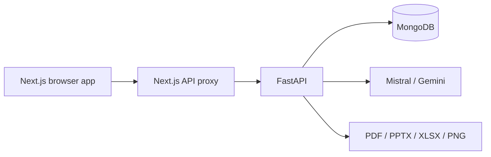

# MargDarshak

**From Blank Page to Blueprint** — a guided workspace for education organizations to design, review, and present a program plan.


An organization can turn a learning problem into a measurable student outcome, select methods, describe changes in stakeholder practice, draw a Theory of Change, plan indicators, and export a readable report. Suggestions are drafts for human review; baselines and local evidence must be verified by the organization.

## Current workflow

1. **Sign up or log in.** Each account has one private organization workspace. The dashboard opens after the account registers its organization.
2. **Register the organization.** Select its thematic focus and enter its geography, scale, and context. A user with multiple themes can switch the active theme in the dashboard.
3. **Define the problem.** Enter a detailed statement, review an AI-refined gist, identify evidence to collect, and build a cause-and-effect problem tree.
4. **Set the student outcome.** Check the outcome against SMART criteria and review a milestone timeline.
5. **Choose methods and people.** Browse relevant methodologies, read full-screen method summaries, save suitable methods, select stakeholders, and describe current and desired practices.
6. **Connect the logic.** Build a Theory of Change with labeled nodes and causal links. Review structural validation and AI suggestions.
7. **Plan measurement.** Generate distinct indicators from the saved outcomes and practices. Enter real baselines, current measurements, targets, and dates to view progress.
8. **Review and share.** Check completeness and design quality, use the design coach, adapt a template if useful, and export the plan.

The dashboard's program map and page guides help users move among these steps without hiding any feature. Templates and methodologies have theme-specific cover images and detail views.

## AI, retrieval, and review

The backend retrieves relevant records from the current organization's work and shared method or template libraries. It ranks these records with embeddings cached in MongoDB, then sends useful context to an LLM. Mistral is the primary provider; Gemini is the fallback when configured. The backend validates structured responses and turns them into user-facing cards and diagrams. For indicator generation, short internal IDs keep each generated measure attached to its original outcome or practice, even when an LLM changes wording.

The design coach and page-specific AI tasks form a guided, task-specific agentic workflow. They propose next steps; they do not autonomously edit or approve an organization's plan. Retrieved records are context, not proof that an unverified claim is true.

## Features and outputs

| Area | What the user gets |
| --- | --- |
| Authentication | Password sign-in, server sessions, and organization ownership checks |
| Problem and causes | Editable problem gist, evidence prompts, and a problem tree |
| Student outcomes | SMART feedback and a visual milestone timeline |
| Methodology | Relevant methods with concise full-screen explanations and saved selections |
| Stakeholders and practices | Organization-specific actor map and short practice suggestions |
| Theory of Change | Labeled causal diagram, structural checks, and improvement suggestions |
| Indicators | Outcome and practice measures, baselines, targets, and progress views |
| Quality check | Input-based completeness and design feedback with links to fix gaps |
| Templates | Searchable starter templates, detail views, and named organization copies |
| Export | Designed PDF, PowerPoint, two Excel workbooks, and Theory of Change PNG |
| Language | English and Hindi interface and translated responses |

The active export choices are **LFA PDF**, **program PowerPoint**, **indicator XLSX**, **budget XLSX**, and **Theory of Change PNG**. Python libraries may support other file types internally, but those are not choices in the current export page.

## Architecture and stack



The frontend uses **Next.js 16, React 19, TypeScript, Tailwind CSS, Radix UI, Zustand, Mermaid, and Recharts**. The backend uses **Python 3.11 or 3.12, FastAPI, PyMongo, HTTPX, ReportLab, Pillow, python-pptx, OpenPyXL, NetworkX, and Matplotlib**. MongoDB holds accounts, organization records, design data, and retrieval embeddings. The browser sends API calls through the same-origin Next.js proxy, which forwards the HTTP-only session cookie to FastAPI.


## Run locally

Use **Python 3.11 or 3.12**, **Node.js 20.9 or newer**, npm, and either local MongoDB or MongoDB Atlas. The backend dependencies belong in `backend/.venv`; this machine's local venv uses Python 3.12.5.

From the repository root, in one terminal:

```powershell
cd backend
python -m venv .venv
.\.venv\Scripts\python.exe -m pip install -r requirements.txt
if (-not (Test-Path .env)) { Copy-Item .env.example .env }
# Edit .env: set MONGODB_URI and at least one of MISTRAL_API_KEY or GEMINI_API_KEY.
.\.venv\Scripts\python.exe -m uvicorn main:app --reload --port 8000
```

In a second terminal:

```powershell
cd frontend
npm ci
# Optional for local use: NEXT_PUBLIC_API_URL defaults to http://localhost:8000.
npm run dev
```

Open `http://localhost:3000`, create an account at `/auth`, then register the organization. API documentation is at `http://localhost:8000/docs`. For deployment, set `NEXT_PUBLIC_API_URL` to the backend URL on the **frontend server** and set the backend variables listed in [`backend/.env.example`](backend/.env.example). Never commit real `.env` files.

The canonical Python dependency list is [`backend/requirements.txt`](backend/requirements.txt); root [`requirements.txt`](requirements.txt) includes it. Always use the venv's Python for backend installs and commands. The deployment Python pin in `backend/.python-version` is 3.11.9. npm dependencies and their versions are in [`frontend/package.json`](frontend/package.json) and [`frontend/package-lock.json`](frontend/package-lock.json).

## Documentation

- [Setup and deployment guide](setup_guide.md)
- [Problem, architecture, and feature walkthrough](PROJECT_OVERVIEW_AND_WORKFLOW.md)
- [Feature reference](features_deep_dive.md)
- [Folder structure](folder_structure.md)
- [Fictional inputs for manual walkthrough](MANUAL_TEST_INPUTS.md)

The deployment URLs currently recorded for this project are in [deployment.txt](deployment.txt). Their availability is independent of this local checkout.
