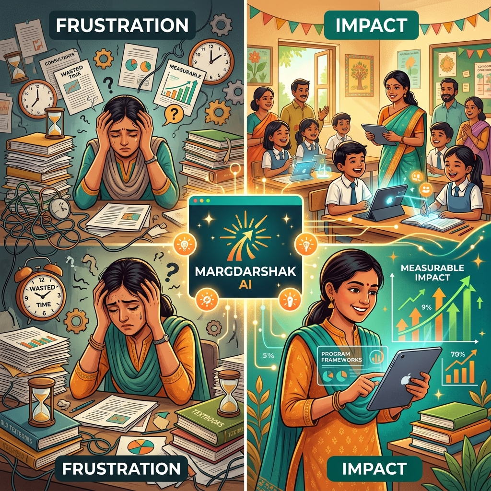
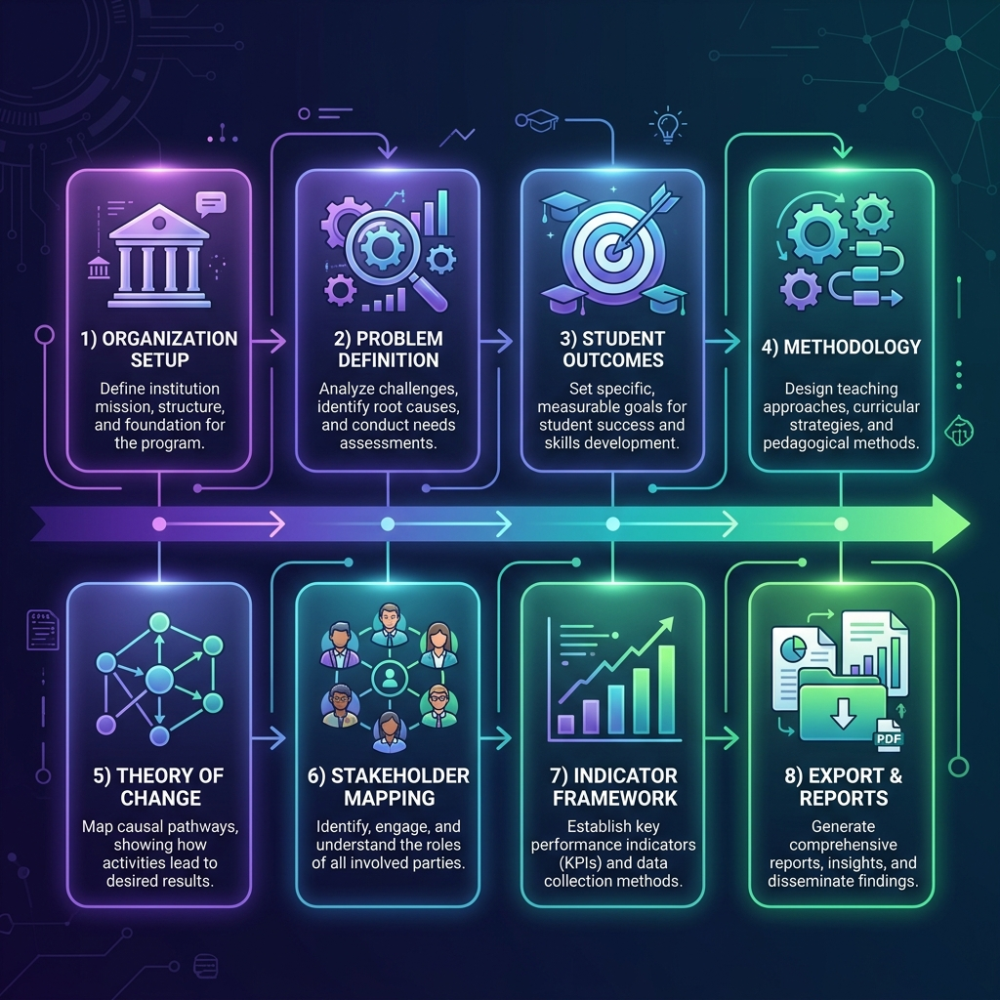
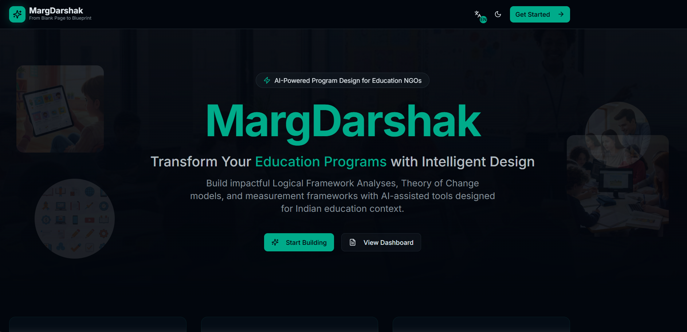
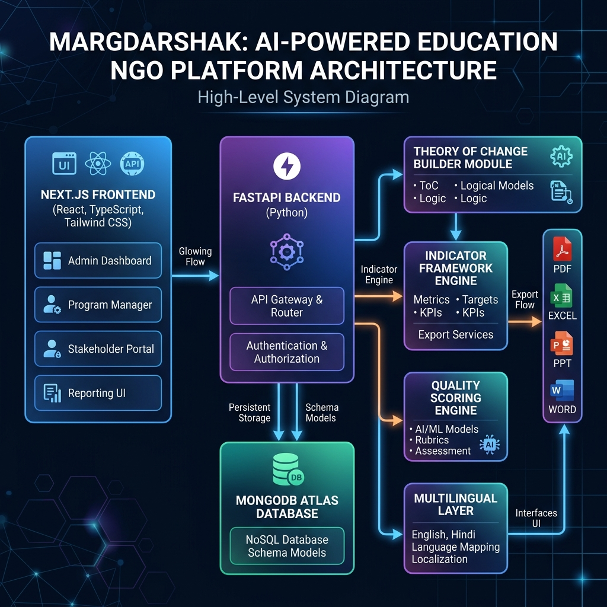

<div align="center">

<!-- Animated Header Banner -->


<!-- Animated Typing SVG -->
<a href="https://git.io/typing-svg"></a>

<!-- Badges Row 1 -->
<p>
  
  
  
  
</p>

<!-- Badges Row 2 -->
<p>
  
  
  
  
</p>

<!-- Live Links -->
<p>
  <a href="https://marg-darshak-shikshalokam.vercel.app" target="_blank">
    
  </a>
  <a href="https://margdarshak-shikshalokam.onrender.com/docs" target="_blank">
    
  </a>
  <a href="https://drive.google.com/file/d/1m7Ifpm9HGC8ybRH3dji7Ht7eIdam4Gg9/view?usp=sharing" target="_blank">
    
  </a>
</p>

<!-- QR Code -->

<br/>
<sub>📱 Scan to test the live demo instantly</sub>

</div>

---

<!-- Animated Separator -->


## 🎯 Problem Statement

<table>
<tr>
<td width="50%">

Education NGOs across India face **deep structural challenges** when designing impactful programs:

| Challenge | Impact |
|-----------|--------|
| 🕐 **High Design Inefficiency** | 50–60% of planning time wasted on unstructured discussions & rework |
| 💸 **Expert Dependency** | External consultants cost ₹5–20 lakhs per design cycle |
| 📉 **Inconsistent Quality** | No standardized frameworks → uneven outcomes across regions |
| ⏳ **Slow Time-to-Launch** | 3–6 months from conceptualization to program approval |
| 🔗 **Weak Impact Linkage** | Daily activities disconnected from student outcomes |
| 📦 **Scaling Barriers** | Poor documentation & unclear logic prevent replication |

</td>
<td width="50%">

<div align="center">

</div>

</td>
</tr>
</table>

> **The Result:** India's social sector loses thousands of design-hours and crores of rupees annually on programs that could have been better designed from day one.

---

## 💡 Solution Overview — How MargDarshak Works

<div align="center">

</div>

<br/>

MargDarshak is an **AI-powered, gamified program design pipeline** that guides Education NGOs from a blank page to a complete, funder-ready program blueprint — in days, not months.

```
📋 Organization Setup
        ↓
🔍 AI-Assisted Problem Definition
        ↓
🎯 SMART Outcome Design
        ↓
📚 Methodology Selection
        ↓
🌐 Theory of Change Builder
        ↓
👥 Stakeholder Mapping
        ↓
📊 Indicator & Measurement Framework
        ↓
✅ Quality Assurance & Scoring
        ↓
📄 Export-Ready LFAs, Reports & Diagrams
```

| Layer | Description |
|-------|-------------|
| 🧠 **AI Design Intelligence** | Assists with problem definition, outcome setting, logic validation, and indicator selection |
| 🎮 **Gamified Workflow Engine** | Breaks complex design into simple, step-by-step tasks with live progress tracking |
| 🗺️ **Context-Aware Logic Modeling** | Ensures coherence between problems, interventions, stakeholders, and impact |
| 📤 **Multi-Output Generation** | Auto-produces LogFrames, Theory of Change diagrams, indicators, and board-ready reports |
| 🌏 **Multilingual Intelligence** | Full English + Hindi support for inclusive design across India |

---

## ✨ Feature Set

<div align="center">

<br/>
<sub><i>MargDarshak Dashboard — Real-time program design progress, quality metrics & workflow</i></sub>
</div>

<br/>

<details open>
<summary><b>🏢 Step 1 — Intelligent Organization Setup</b></summary>
<br/>

- Captures NGO context: geography, theme, scale, and organizational maturity
- Auto-aligns design pathways based on organizational profile
- Manages multiple organization profiles with persistent state
- Creates personalized design journeys for each unique NGO context

</details>

<details open>
<summary><b>🔍 Step 2 — AI-Assisted Problem Definition & Refinement</b></summary>
<br/>

- Guides NGOs to articulate clear, evidence-based problem statements
- AI clarity scoring flags vague or solution-biased problem framing
- Root cause analysis (Problem Tree) engine with ecosystem problem pattern matching
- District-level challenge database for contextual problem alignment

</details>

<details open>
<summary><b>🎯 Step 3 — SMART Student Outcome Designer</b></summary>
<br/>

- Creates age-appropriate, SMART (Specific, Measurable, Achievable, Relevant, Time-bound) learning outcomes
- Aligned to NEP 2020 frameworks and national curricula
- Competency framework library with policy reference integration
- Methodology library for evidence-based intervention selection

</details>

<details open>
<summary><b>📚 Step 4 — Evidence-Based Methodology Selection</b></summary>
<br/>

- Curated methodology library with proven educational interventions
- Context-aware methodology recommendations based on org profile and outcomes
- Links methodologies directly to Theory of Change logic chains
- Supports blended, technology-led, and community-based approaches

</details>

<details open>
<summary><b>🌐 Step 5 — Gamified Theory of Change Builder</b></summary>
<br/>

- Breaks complex logic models into simple, step-by-step cause-to-impact pathways
- Visual network graph generation using NetworkX + Matplotlib
- AI validation of logical coherence and causal linkages
- Pattern library of proven ToC templates from similar NGO programs
- Mermaid.js live diagram rendering in the browser

</details>

<details open>
<summary><b>👥 Step 6 — Stakeholder & Practice Mapping</b></summary>
<br/>

- Maps key system actors: students, teachers, parents, government, CSOs
- Defines required practice changes for each stakeholder role
- Ecosystem mapping for multi-stakeholder program design
- Master stakeholder database with organization-level customization

</details>

<details open>
<summary><b>📊 Step 7 — Indicator & Measurement Framework</b></summary>
<br/>

- Auto-suggests meaningful indicators with baselines, targets, and timelines
- Master indicator library with pre-built education sector metrics
- Target-setting tools with milestone planning
- Links indicators directly to Theory of Change outcomes

</details>

<details open>
<summary><b>✅ Step 8 — Quality Assurance & Completeness Scoring</b></summary>
<br/>

- Real-time LFA completeness scores across all design dimensions
- Multi-dimensional quality evaluation: Clarity, Alignment, Measurability, Logic
- Design quality feedback with actionable improvement suggestions
- Highlights missing or weak program components before submission

</details>

<details open>
<summary><b>📤 Step 9 — Export-Ready Multi-Format Reports</b></summary>
<br/>

- **PDF**: Funder-ready Logical Framework Analysis documents
- **Excel (XLSX)**: Program planning templates and indicator trackers
- **Word (DOCX)**: Narrative program design reports
- **PowerPoint (PPTX)**: Board and donor presentation decks
- **Network Diagrams**: Visual Theory of Change maps
- Background job processing for large export tasks

</details>

<details open>
<summary><b>🌏 Multilingual Support (English + Hindi)</b></summary>
<br/>

- Full interface translation: English ↔ Hindi with one click
- Language-aware AI suggestions and content generation
- Built for inclusive design across India's diverse social sector
- Middleware-based translation architecture for extensibility

</details>

---

## 🛠️ Technology Stack

<div align="center">

### Backend

| Technology | Purpose | Version |
|-----------|---------|---------|
|  **FastAPI** | High-performance Python web framework | Latest |
|  **MongoDB Atlas** | Cloud-native NoSQL database | Cloud |
|  **Python 3.10+** | Core backend language with async support | 3.10+ |
| **ReportLab** | PDF generation engine | Latest |
| **OpenPyXL** | Excel document generation | Latest |
| **python-pptx** | PowerPoint generation | Latest |
| **python-docx** | Word document generation | Latest |
| **NetworkX + Matplotlib** | Theory of Change diagram generation | Latest |
| **googletrans** | Multilingual translation layer | 4.0.0-rc1 |
| **PyMongo** | MongoDB driver | Latest |
| **Pydantic** | Data validation & serialization | Latest |

### Frontend

| Technology | Purpose | Version |
|-----------|---------|---------|
|  **Next.js** | React framework with App Router | 16.0.10 |
|  **React** | UI component library | 19.2 |
|  **TypeScript** | Type-safe development | 5+ |
|  **Tailwind CSS** | Utility-first styling | v4 |
| **shadcn/ui** | Premium accessible component library | Latest |
| **Zustand** | Lightweight state management | 5.0.10 |
| **Recharts** | Data visualization & charts | 2.15.4 |
| **React Hook Form + Zod** | Form handling with schema validation | Latest |
| **next-themes** | Dark/Light mode support | Latest |
| **Lucide React** | Icon library | Latest |

### Infrastructure & Deployment

| Service | Role |
|---------|------|
|  **Render** | Backend API hosting |
|  **Vercel** | Frontend deployment |
| **MongoDB Atlas** | Cloud database (free tier to scale) |

</div>

---

## 🏗️ Architecture Diagram

<div align="center">

</div>

<br/>

```
┌─────────────────────────────────────────────────────────────────────┐
│                        CLIENT (Browser)                              │
│  Next.js 16 + React 19 + TypeScript + Tailwind CSS v4 + shadcn/ui  │
│  ┌──────────┐ ┌──────────┐ ┌──────────┐ ┌──────────┐ ┌──────────┐ │
│  │ Landing  │ │Dashboard │ │ Problem  │ │   ToC    │ │  Export  │ │
│  │  Page    │ │Overview  │ │ Builder  │ │ Builder  │ │  Panel   │ │
│  └──────────┘ └──────────┘ └──────────┘ └──────────┘ └──────────┘ │
│         Zustand State │ react-hook-form │ Recharts Charts           │
└────────────────────────┬────────────────────────────────────────────┘
                         │ HTTP/REST API
                         ▼
┌─────────────────────────────────────────────────────────────────────┐
│                   FASTAPI BACKEND (Python)                           │
│  ┌─────────────┐ ┌─────────────┐ ┌─────────────┐ ┌─────────────┐  │
│  │Organization │ │  Problem    │ │  Theory of  │ │  Indicator  │  │
│  │  Profiles   │ │  Analysis   │ │   Change    │ │  Framework  │  │
│  └─────────────┘ └─────────────┘ └─────────────┘ └─────────────┘  │
│  ┌─────────────┐ ┌─────────────┐ ┌─────────────┐ ┌─────────────┐  │
│  │ Stakeholder │ │  Quality    │ │   Export    │ │ Multilingual│  │
│  │   Mapping   │ │  Scoring    │ │  Generator  │ │   Layer     │  │
│  └─────────────┘ └─────────────┘ └─────────────┘ └─────────────┘  │
│                         CORS + Pydantic + Async                      │
└────────────────────────┬────────────────────────────────────────────┘
                         │ PyMongo Driver
                         ▼
┌─────────────────────────────────────────────────────────────────────┐
│                    MONGODB ATLAS (Cloud)                             │
│  25+ Collections: org_profiles | problem_statements | theory_of_    │
│  change | stakeholders | indicators | lfa_scores | export_jobs ...  │
└─────────────────────────────────────────────────────────────────────┘
```

---

## 📁 Repository Navigation Guide

> **Find exactly what you need — fast.**

| 📄 File / Folder | 📍 Location | 📝 Purpose |
|-----------------|------------|-----------|
| **README.md** | `/README.md` | 🗺️ This file — project overview, architecture, features |
| **setup_guide.md** | `/setup_guide.md` | ⚙️ Complete local setup & deployment instructions |
| **folder_structure.md** | `/folder_structure.md` | 🗂️ Annotated directory tree of entire project |
| **features_deep_dive.md** | `/features_deep_dive.md` | 🔬 In-depth feature analysis, impact & uniqueness |
| **requirements.txt** | `/requirements.txt` | 📦 Full project requirements summary |
| **Backend API** | `/backend/main.py` | 🐍 All FastAPI routes, models, and business logic |
| **Backend Requirements** | `/backend/requirements.txt` | 🐍 Python dependencies |
| **Frontend Entry** | `/frontend/app/page.tsx` | ⚛️ Landing page with hero, features, stats |
| **Dashboard** | `/frontend/app/dashboard/` | 📊 All dashboard workflow pages |
| **Organization Setup** | `/frontend/app/dashboard/organization/` | 🏢 Organization profile page |
| **Problem Definition** | `/frontend/app/dashboard/problem/` | 🔍 Problem analysis page |
| **Student Outcomes** | `/frontend/app/dashboard/outcomes/` | 🎯 SMART outcomes designer |
| **Methodology** | `/frontend/app/dashboard/methodology/` | 📚 Methodology selector |
| **Theory of Change** | `/frontend/app/dashboard/theory-of-change/` | 🌐 ToC builder with visual graph |
| **Stakeholders** | `/frontend/app/dashboard/stakeholders/` | 👥 Stakeholder mapping module |
| **Indicators** | `/frontend/app/dashboard/indicators/` | 📊 Measurement framework builder |
| **Quality Check** | `/frontend/app/dashboard/quality/` | ✅ LFA completeness scoring |
| **Export** | `/frontend/app/dashboard/export/` | 📤 Multi-format report generation |
| **Templates** | `/frontend/app/dashboard/templates/` | 📋 Pre-built program design templates |
| **Settings** | `/frontend/app/dashboard/settings/` | ⚙️ Application settings |
| **Components** | `/frontend/components/` | 🧩 Reusable React components |
| **Language Provider** | `/frontend/components/language-provider.tsx` | 🌏 EN/HI multilingual engine |
| **Dashboard Layout** | `/frontend/components/dashboard-layout.tsx` | 📐 Sidebar + layout wrapper |
| **Sidebar Navigation** | `/frontend/components/sidebar-nav.tsx` | 🧭 Step-based navigation |
| **State Management** | `/frontend/lib/store.ts` | 🗄️ Zustand global state |
| **Deployment Info** | `/deployment.txt` | 🚀 Live backend & frontend URLs |
| **QR Code** | `/MargDarshak QR.png` | 📱 Scan to access live demo |
| **Setup (Legacy)** | `/setup.txt` | 📜 Original setup notes (see setup_guide.md) |
| **Instructions (Legacy)** | `/instructions.txt` | 📜 Original instructions |

---

## 🚀 Quick Start

```bash
# 1. Clone the repository
git clone https://github.com/vedantjn27/MargDarshak-Shikshalokam.git
cd MargDarshak-Shikshalokam

# 2. Setup Backend
cd backend
python -m venv venv
venv\Scripts\activate          # Windows
pip install -r requirements.txt
# Create .env with MONGODB_URI and DB_NAME
uvicorn main:app --reload --port 8000

# 3. Setup Frontend (new terminal)
cd frontend
npm install
# Create .env.local with NEXT_PUBLIC_API_URL=http://localhost:8000
npm run dev
```

📖 **Full detailed setup**: See [`setup_guide.md`](./setup_guide.md)

---

## 🌐 Live Deployment

| Service | URL | Status |
|---------|-----|--------|
| 🖥️ **Frontend (Vercel)** | [marg-darshak-shikshalokam.vercel.app](https://marg-darshak-shikshalokam.vercel.app) |  |
| 📡 **Backend API (Render)** | [margdarshak-shikshalokam.onrender.com](https://margdarshak-shikshalokam.onrender.com) |  |
| 📘 **API Docs (Swagger)** | [.../docs](https://margdarshak-shikshalokam.onrender.com/docs) |  |
| 🎬 **Demo Video** | [Google Drive](https://drive.google.com/file/d/1m7Ifpm9HGC8ybRH3dji7Ht7eIdam4Gg9/view?usp=sharing) |  |

---

## 🌟 Unique Differentiators

<table>
<tr>
<td align="center" width="33%">
<h3>🧠 Program Design Intelligence</h3>
Focuses on <b>design quality BEFORE implementation</b> — unlike monitoring or tracking tools that only measure what's already done.
</td>
<td align="center" width="33%">
<h3>🔍 Explainable AI</h3>
Every AI suggestion is <b>transparent and auditable</b> — suitable for NGOs, government reviewers, and international funders.
</td>
<td align="center" width="33%">
<h3>🎮 Gamified Learning-by-Doing</h3>
Reduces cognitive load for non-experts through <b>step-by-step guided workflows</b> with real-time progress feedback.
</td>
</tr>
<tr>
<td align="center">
<h3>🗺️ Contextual Adaptation</h3>
Geography-, theme-, and maturity-aware guidance makes every design journey <b>specific to your organization's reality</b>.
</td>
<td align="center">
<h3>📤 Multi-Stakeholder Outputs</h3>
One design process → <b>PDF, Excel, Word, PPT, and visual diagrams</b> — ready for funders, boards, and government partners.
</td>
<td align="center">
<h3>🌏 Built for India</h3>
Full <b>Hindi + English</b> support, NEP 2020 alignment, and district-level contextual intelligence for India's social sector.
</td>
</tr>
</table>

---

## 📈 Impact & Benefits

```
╔══════════════════════════════════════════════════════════════════════╗
║                    MEASURABLE OUTCOMES                              ║
╠════════════════════════╦════════════════════════╦════════════════════╣
║  70–90% REDUCTION      ║  Months → Days         ║  2–3× IMPROVEMENT  ║
║  in consultant costs   ║  in program design     ║  in design quality ║
╠════════════════════════╩════════════════════════╩════════════════════╣
║  STRATEGIC OUTCOMES                                                  ║
║  ✅ Capacity Building: NGOs develop in-house program design ability  ║
║  ✅ Scaling Enablement: Programs become replicable across regions    ║
║  ✅ Funder Alignment: Standardized outputs meet donor requirements   ║
║  ✅ Systemic Change: Design quality → implementation quality         ║
╠══════════════════════════════════════════════════════════════════════╣
║  MARKET ADOPTION GOALS                                               ║
║  🎯 150+ NGOs in the Shikshagraha network                           ║
║  🎯 1,000+ education CSOs nationally within 3 years                 ║
║  🎯 10,000+ programs designed on MargDarshak                        ║
║  🎯 Become the standard digital platform for education program       ║
║     design in India                                                  ║
╚══════════════════════════════════════════════════════════════════════╝
```

---

## 📊 Platform Statistics

<div align="center">

| Metric | Value |
|--------|-------|
| 🏢 NGOs Supported | **500+** |
| 📋 Programs Designed | **10,000+** |
| 🗺️ Indian States Covered | **20** |
| 📤 Export Formats | **4** (PDF, Excel, Word, PPT) |
| 🗄️ MongoDB Collections | **25+** |
| 🌐 Languages Supported | **2** (English + Hindi) |
| 🔗 API Endpoints | **50+** |

</div>

---

## 📚 Documentation Index

| Document | Description |
|---------|-------------|
| [`setup_guide.md`](./setup_guide.md) | Full installation, configuration & deployment guide |
| [`folder_structure.md`](./folder_structure.md) | Annotated directory tree with file purpose descriptions |
| [`features_deep_dive.md`](./features_deep_dive.md) | Deep-dive into every feature: impact, uniqueness & technical detail |
| [`requirements.txt`](./requirements.txt) | Project-level dependency reference |
| [`backend/requirements.txt`](./backend/requirements.txt) | Python backend dependencies |

---


<div align="center">

<!-- Animated Footer -->


### 🌟 Built with ❤️ for India's Education Social Sector


**_"From intention to impact — MargDarshak turns ideas into implementable change."_**

<br/>

[](https://fastapi.tiangolo.com)
[](https://vercel.com)
[](https://mongodb.com)

</div>